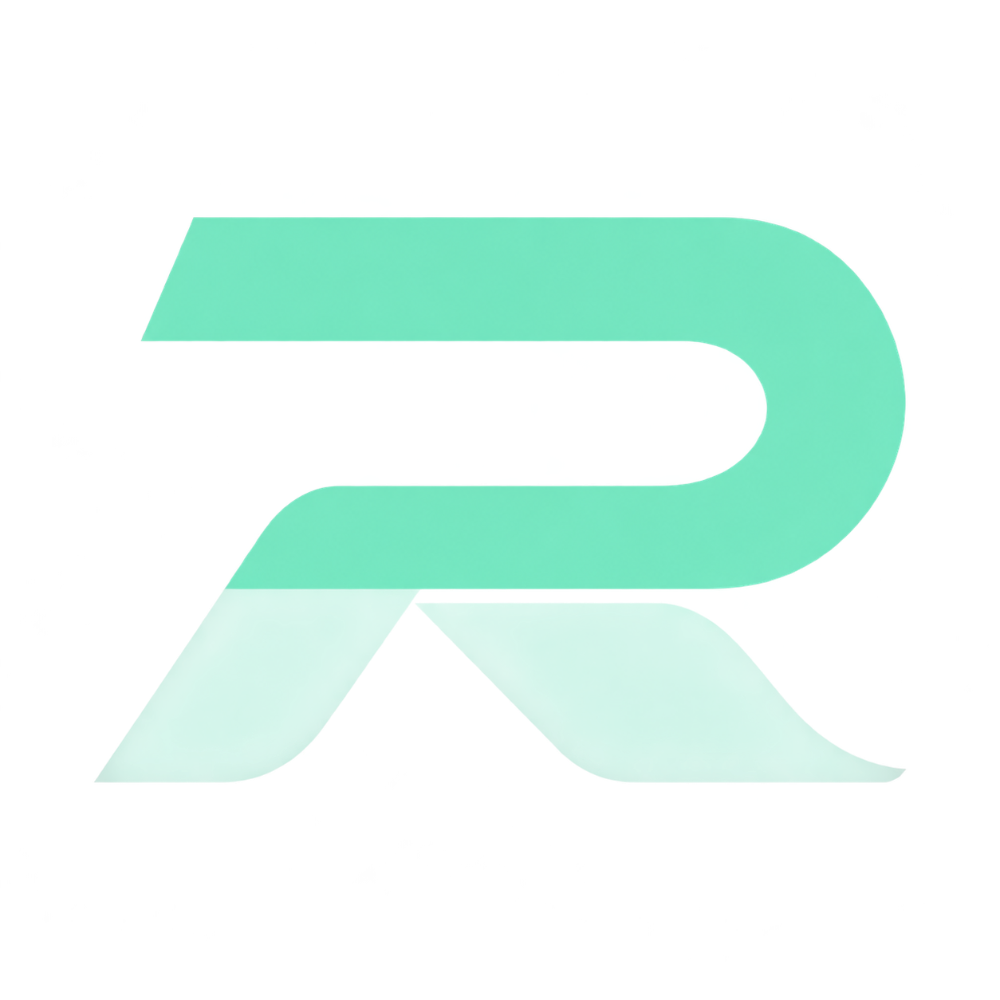

  

  Always the latest Roblox, one click away.

## What it does

Rave keeps its own copy of the Roblox client in `%LOCALAPPDATA%\Rave`. Every time you hit **Launch Roblox** it checks the newest version, downloads and verifies it straight from the Roblox servers if needed, and starts it. No Roblox installer, no admin prompt.

- **Accounts** - add your Roblox accounts with Quick Log In (code or QR) or a `.ROBLOSECURITY` cookie, pick one and Roblox opens already signed in. Accounts are stored encrypted with Windows DPAPI, so only your Windows user can read them. Your password is never asked for.
- **FFlags editor** - write, import and export FFlags as JSON, or switch on presets like Potato mode, no grass or Vulkan with one click. Presets only use flags Roblox still accepts. Your flags are applied every time Roblox starts, even after an update.
- **Skins** - give your weapons a new look in Prison Life (community, VALORANT and Counter-Strike 2 skins with their own 3D models, the M700 included, Rave colors or skins you add yourself), with a 3D or image preview of every skin. Rave swaps the textures and models in your local Roblox cache, so only you see them, and choosing Original puts the real textures back.
- **Website joins** - on by default: the Play button on roblox.com starts Roblox through Rave, with your FFlags and skins. Turn it off and the official Roblox launcher gets the links back.
- **Best server** - on by default: every website join goes to the open server closest to you (by an estimated ping). Joins to friends and private servers stay as they are.
- **Discord status** - shows the game you are playing, its icon and how long you have been in it in your Discord status, and that you are in the Rave launcher while Roblox is closed.
- **Settings** - keep Rave open, minimize it or hide it while Roblox runs (it comes back when Roblox closes), choose an accent color, and switch website joins, best server and the Discord status on or off.
- **Info** - Rave and Roblox versions, your specs and a HardwareID that never leaves your PC.

Rave runs without admin rights, has no telemetry and writes no log files. It only talks to Microsoft for a connection check, to Roblox, to GitHub to look for Rave updates, and, for the best server finder, to ipinfo.io or ipwho.is (your rough location) and RoValra (where the Roblox servers are). The Discord status goes only to the Discord app on your PC (Discord loads the Rave logo for it from GitHub). The exact list is in section 8 of the [license](LICENSE).

## Install

Download `Rave-Installer.exe` from the [releases](https://github.com/elistrrdev/Rave/releases) and run it. Setup puts Rave in `C:\Program Files\Rave`, adds the shortcuts you choose and registers an uninstaller in Apps and Features.

After that Rave keeps itself up to date. When a new version is out, Rave installs it on its own the next time it starts. Windows asks for admin rights for the update, the same as for the first install.

Requires Windows 10 or 11 (64-bit).

## Source

The code is public so anyone can see what Rave does with their PC and their accounts. That does not make it open source: Rave is proprietary and all rights are reserved. Please read the [license](LICENSE) before using it.

Rave is not affiliated with, endorsed by or connected to Roblox Corporation.

Copyright (c) 2026 elistrrdev. All rights reserved.
