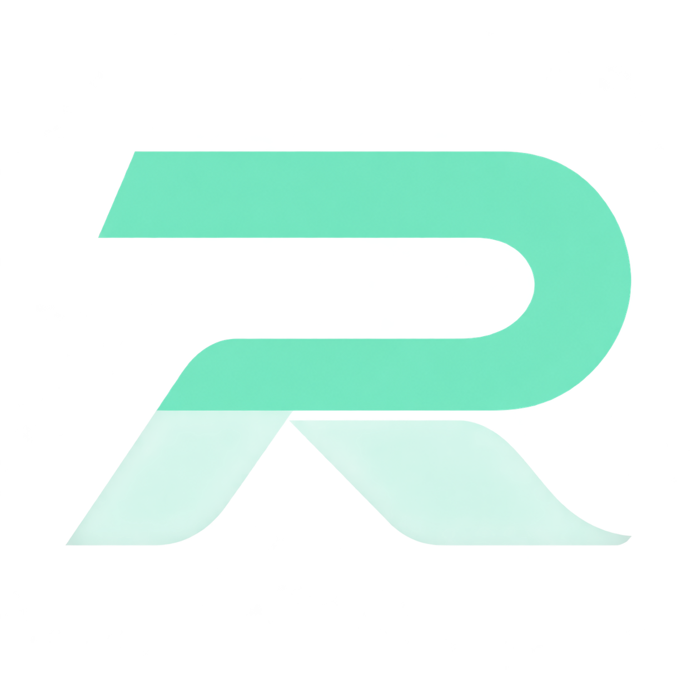

  

  Always the latest Roblox, one click away.

## What it does

Rave keeps its own copy of the Roblox client in `%LOCALAPPDATA%\Rave`. Every time you hit **Launch Roblox** it checks the newest version, downloads and verifies it straight from the Roblox servers if needed, and starts it. No Roblox installer, no admin prompt.

- **Accounts** - add your Roblox accounts with Quick Log In (code or QR) or a `.ROBLOSECURITY` cookie, pick one and Roblox opens already signed in. Accounts are stored encrypted with Windows DPAPI, so only your Windows user can read them. Your password is never asked for.
- **FFlags editor** - write, import and export FFlags as JSON. They are applied every time Roblox starts, even after an update.
- **Settings** - keep Rave open, minimize it or hide it while Roblox runs (it comes back when Roblox closes), and choose an accent color.
- **Info** - Rave and Roblox versions, your specs and a HardwareID that never leaves your PC.

Rave runs without admin rights, has no telemetry and writes no log files. It only talks to Microsoft for a connection check and to Roblox. The exact list is in section 8 of the [license](LICENSE).

## Install

Download `Rave-Installer.exe` from the [releases](https://github.com/elistrrdev/Rave/releases) and run it. Setup puts Rave in `C:\Program Files\Rave`, adds the shortcuts you choose and registers an uninstaller in Apps and Features.

Requires Windows 10 or 11 (64-bit).

## Source

The code is public so anyone can see what Rave does with their PC and their accounts. That does not make it open source: Rave is proprietary and all rights are reserved. Please read the [license](LICENSE) before using it.

Rave is not affiliated with, endorsed by or connected to Roblox Corporation.

Copyright (c) 2026 elistrrdev. All rights reserved.
